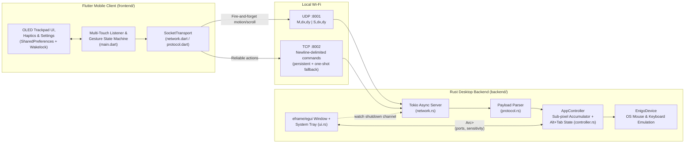

# Remote Trackpad

[](https://www.rust-lang.org/)
[](https://tokio.rs/)
[](https://github.com/emilk/egui)
[-02569B?style=flat-square&logo=flutter&logoColor=white)](https://flutter.dev/)
[](https://github.com/Dudek03/remote_trackpad/actions)

Remote Trackpad is a monorepo containing a Rust desktop backend and a Flutter mobile client for controlling a desktop machine over local Wi-Fi.

Designed for ultra-low latency and laptop-grade ergonomics, it combines **UDP datagrams** for smooth cursor motion and scrolling with a **persistent TCP channel** for reliable clicks, window switching, volume control, virtual desktops, media playback, and browser navigation.

---

## Key Features

- **Hybrid UDP + TCP Transport:** Streams high-frequency cursor movement (`M,dx,dy`) and scrolling (`S,dx,dy`) over **UDP port `8001`** while delivering discrete commands over a persistent newline-delimited **TCP port `8002`** connection (with automatic one-shot TCP fallback).
- **Sub-Pixel Cursor Accumulation:** The Rust controller (`AppController`) multiplies incoming deltas by a configurable sensitivity factor (`0.1`–`10.0`) and accumulates fractional remainders so slow, precise movements stay jitter-free.
- **Rich Multi-Touch & Anchor ("Kotwica") Gestures:** Full-screen OLED-black trackpad with 1-finger pointing/clicking, 2-finger scrolling, a 2-finger **Anchor** gesture (hold 1 finger still + slide a 2nd finger) for `Alt+Tab` window switching and volume control, 3-finger fallback gestures, and customizable 4-finger desktop/window/media/browser shortcuts.
- **Live Feedback & Screen Wakelock:** Haptic feedback, active touch-counter indicator, transient HUD status pill, and `wakelock_plus` keep the trackpad awake and responsive during use.
- **Native Rust Desktop UI & System Tray:** Lightweight `eframe`/`egui` desktop window displaying the host's local IP, editable UDP/TCP ports and sensitivity, and minimize-to-tray support (`tray-icon` + Win32 window hiding/restoring on Windows).

---

## Architecture & Protocol



---

## Structure

- `backend/`: Rust server with UDP/TCP handling, tray-style desktop integration, and input emulation.
  - `src/main.rs` — Spawns the multi-threaded Tokio server thread alongside the `eframe` UI loop with graceful shutdown.
  - `src/network.rs` — Concurrent UDP (`8001`) datagram receiver and TCP (`8002`) line-buffered client listener.
  - `src/protocol.rs` — Parsers for `UdpPacket` (`Move`, `Scroll`) and all 18 `TcpCommand` variants.
  - `src/controller.rs` — `InputDevice` trait, `EnigoDevice` OS input emulator, and `AppController` (fractional delta accumulator + `Alt+Tab` hold/release state machine).
  - `src/ui.rs` — `egui` server configuration window, local IP lookup (`local-ip-address`), and system tray integration (`tray-icon` + Win32 show/hide hooks).
  - `tests/` — Integration and unit tests (`protocol_and_controller.rs`, `ui_tests.rs`).
- `frontend/`: Flutter client with gesture-driven controls and hidden settings access.
  - `lib/main.dart` — Full-screen multi-touch gesture engine, HUD, haptics, settings dialog, and `SharedPreferences` persistence.
  - `lib/network.dart` — `RemoteTrackpadClient` and `SocketTransport` (reusable UDP socket + persistent TCP socket with one-shot reconnect fallback).
  - `lib/protocol.dart` — Shared port constants (`8001`, `8002`) and packet formatters.
  - `test/` — Unit, gesture, network, protocol, and widget test suites (`app_logic_test.dart`, `gesture_test.dart`, `network_test.dart`, `protocol_test.dart`, `widget_test.dart`).
- `artifacts/`: CI/CD output directory for release binaries and packages.
- `.github/workflows/`: GitHub Actions definition for testing and release artifact generation.

---

## Touch Controls & Gestures

| Gesture | Movement / Action | Command Sent | Desktop Result |
| :--- | :--- | :--- | :--- |
| **1 Finger** | Drag | UDP `M,dx,dy` | Move mouse cursor (scaled by backend sensitivity) |
| **1 Finger** | Single tap | TCP `left_click` | Left mouse click |
| **1 Finger** | Double tap | TCP `right_click` | Right mouse click |
| **2 Fingers** | Move both together (≥ 15 px) | UDP `S,0,dy` | Vertical scroll |
| **2-Finger Anchor (*Kotwica*)** | Hold 1 finger still (≤ 25 px) + slide 2nd horizontally | TCP `alt_tab_next` / `alt_tab_prev` (→ `alt_tab_end` on lift) | Holds `Alt`, steps through windows with `Tab` / `Shift+Tab`, releases `Alt` on lift |
| **2-Finger Anchor (*Kotwica*)** | Hold 1 finger still (≤ 25 px) + slide 2nd up/down | TCP `volume_up` / `volume_down` | Adjusts system volume in steps |
| **3 Fingers (Fallback)** | Swipe horizontally | TCP `alt_tab_next` / `alt_tab_prev` (→ `alt_tab_end`) | `Alt+Tab` window switcher |
| **3 Fingers (Fallback)** | Swipe up / down | TCP `volume_up` / `volume_down` | System volume up / down |
| **4 Fingers (Horizontal)** | Swipe left / right *(configurable in Settings)* | `desktop_left`/`desktop_right` (default), `media_prev`/`media_next`, or `browser_back`/`browser_forward` | Switch virtual desktops (`Ctrl+Win+←/→`), skip media track, or browser Back/Forward (`Alt+←/→`) |
| **4 Fingers (Vertical)** | Swipe down / up *(configurable in Settings)* | `window_minimize`/`window_maximize` (default) or `show_desktop` | Minimize/Maximize active window (`Win+↓/↑`) or toggle desktop (`Win+D`) |

> **Opening Settings on Mobile:** Tap the bottom-right **Settings** hidden tap zone **3 times within 1 second** (or tap the bottom-left **Gesty / IP** button) to configure the backend IP address and customize 4-finger gesture bindings.

---

## Wire Protocol Reference

### UDP (Default Port `8001`)

Plain UTF-8 CSV datagrams for low-overhead continuous input:

- **Cursor Move:** `M,<dx>,<dy>` (e.g., `M,4.5,-2.0`)
- **Scroll:** `S,<dx>,<dy>` (e.g., `S,0.0,12.0`)

### TCP (Default Port `8002`)

Newline-delimited (`\n`) UTF-8 command strings:

| Category | Supported Commands |
| :--- | :--- |
| **Mouse Clicks** | `left_click`, `right_click`, `double_click` |
| **Window Switcher** | `alt_tab_start`, `alt_tab_next`, `alt_tab_prev`, `alt_tab_end` |
| **System Audio** | `volume_up`, `volume_down` |
| **Window & Desktop** | `window_minimize`, `window_maximize`, `show_desktop`, `desktop_left`, `desktop_right` |
| **Media & Browser** | `media_next`, `media_prev`, `browser_back`, `browser_forward` |

---

## Local Setup

### Backend

From the repository root:

```powershell
cd backend
cargo test
cargo build --release
```

To run the desktop server directly during development:

```powershell
cd backend
cargo run --release
```

The backend uses `backend/Cargo.toml` and runs on UDP port `8001` for motion/scroll payloads and TCP port `8002` for click/command payloads.

When launched, the **Remote Trackpad Server** desktop window displays your local LAN IP and lets you adjust the UDP port, TCP port, and cursor sensitivity (`0.1`–`10.0`). Closing the window minimizes the server to the system tray; right-click or click the tray icon to restore the window or shut down the server cleanly.

### Frontend

From the repository root:

```powershell
cd frontend
flutter pub get
flutter test
flutter build apk --release
```

The Flutter client sends UDP move/scroll packets to the backend and TCP command packets for clicks, Alt+Tab, and volume control.

### CI/CD Pipeline

Pushes to `master` (or manual `workflow_dispatch`) trigger `.github/workflows/build.yml`, which runs all tests and uploads release artifacts:

| Job | Runner | Artifact |
| :--- | :--- | :--- |
| `backend-test` → `backend-build` | `windows-latest` | `remote-trackpad-backend.exe` |
| `frontend-test` → `frontend-build-android` | `ubuntu-latest` | `remote-trackpad-client.apk` |
| `frontend-test` → `frontend-build-ios` | `macos-latest` | `remote-trackpad-client.ipa` (unsigned) |

### Notes

- Ensure Rust and Cargo are installed for backend development.
- Ensure Flutter is installed and available on your PATH for frontend development.
- Use the hidden tap zone in the app to open server settings and configure the backend IP.
